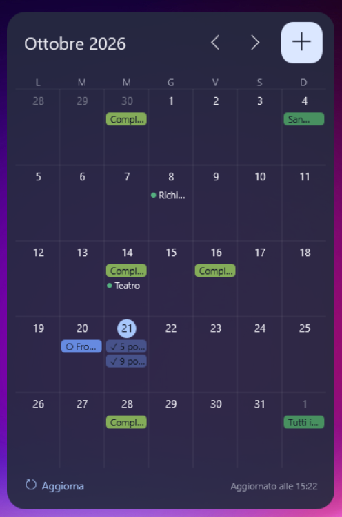

# Rainmeter Calendar

A [Rainmeter](https://www.rainmeter.net/) desktop widget for Windows that shows a **month view of Google Calendar
and Google Tasks**, and lets you create, complete and delete events and tasks without opening the browser.

🇮🇹 **Versione italiana:** [it/README.md](it/README.md)



## Features

- Month grid with all the calendars ticked in your Google account, in Google's colours.
  All-day and multi-day events are bars, timed events are a dot, as on calendar.google.com.
- Google Tasks with a due date (○ to do, ✓ completed).
- Click a day → list of that day; click an item → details as on Google (time, Google Meet link, location with a link to Maps, calendar, creator, description or task notes) and **Open**, **Delete**, **Complete** (tasks).
- **+** button → create an event (title, date, time or all day, calendar) or a task (title, date, list).
- Automatic sync (every minute by default) plus a **Refresh** button.
- English and Italian interface, easy to translate.
- Runs only on your PC: it talks directly to Google's APIs, there is no server in between.

## How it works

```
GCal.lua  ──request.txt──►  gcal.ps1  ──HTTPS──►  Google Calendar / Tasks APIs
   ▲                           │
   └────────── data.tsv ◄──────┘
```

`GCal.lua` (Rainmeter's Lua script) draws the widget. `gcal.ps1` (Windows PowerShell 5.1, built into Windows)
handles the Google sign-in (OAuth) and the API calls, and writes the data to `data.tsv`.
Nothing else needs to be installed.

## Repository contents

```
README.md                           this guide (English)
it/                                 Italian guide and Italian versions of the web pages
docs/screenshot.png                 screenshot
index.html, privacy.html            home page and privacy policy, served by GitHub Pages
LICENSE                             MIT license
rainmeter/GoogleCalendar/           the skin: copy this folder into Rainmeter's Skins folder
  GoogleCalendar.ini                skin (generated by @Resources/Tools/gen_ini.py)
  @Resources/Variables.inc          settings: language, sync interval, size, colours
  @Resources/Lang/en.inc, it.inc    interface texts
  @Resources/Scripts/GCal.lua       grid, panels, form (UTF-16 LE file)
  @Resources/Scripts/gcal.ps1       Google sign-in and API calls
  @Resources/Tools/gen_ini.py       regenerates GoogleCalendar.ini
  @Resources/Google/                put client_secret.json here (see below)
```

---

## Installation

You need: Windows 10/11, a Google account. Total time the first time: about 20 minutes.

### 1. Install Rainmeter and the skin

1. Install [Rainmeter](https://www.rainmeter.net/) (standard installation).
2. On this page click **Code → Download ZIP** and extract it.
3. Copy the folder `rainmeter/GoogleCalendar` into Rainmeter's skins folder, usually
   `Documents\Rainmeter\Skins` (Rainmeter → Manage → "Open folder" shows where it is).
4. Rainmeter → **Manage** → **Refresh all** → select `GoogleCalendar` → `GoogleCalendar.ini` → **Load**.
   The widget appears and says it needs Google to be set up.
5. Optional: open `@Resources/Variables.inc` and set `Language=en` or `Language=it`.

### 2. Create your Google Cloud project (free)

Google requires every app that uses its APIs to have its own OAuth client. You create it in your own account,
for free. **No credit card is needed.**

1. Open <https://console.cloud.google.com/> and sign in.
2. If you are offered a **"Free trial / $300 credit"**, **do not start it**: it is not needed, it asks for a card,
   and when it ends Google shuts down the projects linked to it.
3. Project selector at the top → **New project** → name `Rainmeter Calendar` → **Create**, then make sure it is selected.
4. Menu → **APIs & Services** → **Library**: search **Google Calendar API** → **Enable**;
   search **Google Tasks API** → **Enable**.

### 3. Configure the consent screen (Google Auth Platform)

1. Menu → **Google Auth Platform** → **Get started**: app name `Rainmeter Calendar`, support email = yours,
   audience **External**, contact email = yours → accept and **Create**.
2. Choose one of the two options below.

**Option A — Testing mode (fastest, 2 minutes).**
**Audience** → **Test users** → **Add users** → add your Gmail address → **Save**.
Drawback: in testing mode Google makes the sign-in expire **every 7 days**. When it happens the widget keeps the
last data and shows "Google access expired or revoked (click here)": one click and a confirmation in the browser.

**Option B — Published app (no weekly expiry, ~10 more minutes).**
To publish, Google asks for a public home page and privacy policy. You can host them for free with GitHub Pages:

1. Create a free [GitHub](https://github.com) account if you don't have one.
2. Create a new **public** repository named exactly `YOURNAME.github.io` (`YOURNAME` = your GitHub username).
3. Upload `index.html` and `privacy.html` from this repository (you can keep them as they are: they describe the
   widget, not you).
4. Repository **Settings** → **Pages** → Source **Deploy from a branch** → `main`, `/ (root)` → **Save**.
   After 1–2 minutes the site is online at `https://YOURNAME.github.io/`.
5. Google Auth Platform → **Branding**:
   - Application home page: `https://YOURNAME.github.io/`
   - Privacy policy link: `https://YOURNAME.github.io/privacy.html`
   - Authorised domains: `YOURNAME.github.io`
   - **Do not upload a logo** (a logo triggers Google's verification process). **Save**.
6. **Audience** → **Publish app** → **Confirm**. The status becomes "In production".
   Publishing does not make the app visible to anyone and does not require Google's verification.
7. If Google asks you to prove that you own the domain: [Google Search Console](https://search.google.com/search-console)
   → add a **URL prefix** property `https://YOURNAME.github.io/` → method **HTML file** → upload the downloaded
   `googleXXXX.html` to the root of your repository → **Verify**.

### 4. Create the OAuth client

1. Google Auth Platform → **Clients** → **Create client** → application type **Desktop app** → any name → **Create**.
2. Download the JSON file and save it as
   `GoogleCalendar\@Resources\Google\client_secret.json`.
   **Keep it private**: never upload it to GitHub or share it.

### 5. Connect the widget

1. Right-click the widget → **Connect / reconnect Google account** (or click the message at the bottom right).
2. The browser opens: choose your account. Google warns that the app is not verified — normal for a personal app:
   **Advanced** → **Go to Rainmeter Calendar (unsafe)** → allow access to Calendar and Tasks.
3. When the page says "Done", go back to the widget: events and tasks appear within a few seconds.

### Another PC

The Google project and OAuth client are reused, they are **not** created again.

1. Install Rainmeter and copy `rainmeter/GoogleCalendar` as in step 1.
2. Copy your `client_secret.json` from the first PC into `@Resources\Google\` (USB stick or another private channel).
3. Load the skin and connect it (step 5). Do **not** copy `token.dat`: it is encrypted for one Windows user on one PC.

---

## Settings

All in `rainmeter/GoogleCalendar/@Resources/Variables.inc` (after editing: right-click → **Refresh skin**).

| Setting | Meaning |
|---|---|
| `Language` | `en` or `it` (file in `@Resources/Lang/`) |
| `RefreshSeconds` | seconds between automatic syncs, minimum and default `60` |
| `WeekStart` | `1` = Monday, `0` = Sunday |
| `Width`, `CellHeight` | widget size in pixels |
| `ColorMap`, `ColorMapTimed` | convert Google's API colours to the colours of the website (see below) |
| `ColorTask`, `ColorTaskDone`, `ColorBirthday` | colours of tasks and birthdays |

**Why ColorMap?** The API returns calendar colours from Google's old palette, lighter than the ones the website
shows. `ColorMap=apiColour=wantedColour;...` converts them for bars, `ColorMapTimed` for the dot of timed events.
The API colour of each calendar is in the `C` rows of `@Resources/Google/data.tsv`. The defaults match Google's
dark theme for the "Sage" and "Basil" calendar colours.

## API usage limits

Checked on Google's documentation (October 2026):

| API | Limits | Cost |
|---|---|---|
| Google Calendar API | 10,000 requests/minute per project, 600/minute per user | Standard use at no additional cost. Google has announced charges only above 1,000,000 requests/day per project, with at least 90 days' notice. |
| Google Tasks API | 50,000 requests/day | No pricing stated on the limits page. |

Usage of the widget: each sync makes **2 + (number of calendars)** Calendar requests (colours, calendar list,
events of each calendar) and **1 + (number of task lists)** Tasks requests, plus one token refresh.
Example with 3 calendars and 1 task list, syncing every minute: **7 requests/minute**, about
**7,200 Calendar + 2,900 Tasks requests per day** per PC — far below every limit, even with several PCs on the
same Google project. Creating, completing or deleting costs one extra request plus a sync.

Each sync starts a short PowerShell process (about one second of CPU time).

## Known limitations

- **Repeating tasks**: the Google Tasks API does not expose repetitions. For a repeating task only the current
  occurrence is returned, so its future (and past) occurrences shown on calendar.google.com do not appear here.
  Repeating **events** are fully supported.
- Tasks without a due date have no day, so they are not shown.
- Deleting a repeating event from the widget deletes only that occurrence.
- Each cell shows 3 rows; the rest becomes "+N more" (click for the full list).
- Times are shown in the PC's time zone.

## Privacy

- The widget talks only to Google's APIs; there is no server and nothing is sent to the author or third parties.
- `client_secret.json`, `token.dat`, `data.tsv` and `request.txt` stay on your PC and are excluded by `.gitignore`.
- The sign-in token is encrypted with Windows DPAPI.
- Revoke access at any time: <https://myaccount.google.com/permissions>.
- Full text: [privacy.html](privacy.html).

## Development notes

- `GCal.lua` and `Lang/it.inc` must stay **UTF-16 LE**: it is the only way Rainmeter handles non-ASCII text in Lua
  and include files. `.gitattributes` (`* -text`) keeps them byte-for-byte; GitHub shows `GCal.lua` as binary.
- The panel coordinates are shared between `gen_ini.py` and `GCal.lua` (see the comments at the top of both).
- After changing `gen_ini.py`: `python gen_ini.py ..\..\GoogleCalendar.ini` from `@Resources/Tools`.
- To add a language: copy `Lang/en.inc` to `Lang/<code>.inc`, translate the values (keep the `%s` placeholders),
  save as UTF-16 LE if it contains non-ASCII characters, then set `Language=<code>`.

## License

MIT
