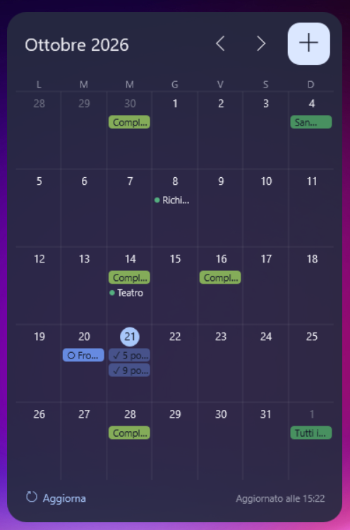

# Rainmeter Calendar (italiano)

Widget per [Rainmeter](https://www.rainmeter.net/) (Windows) con la **vista mensile di Google Calendar e Google Tasks**:
crea, completa ed elimina eventi e attività senza aprire il browser.

Il repository contiene anche **Note adesive**, un secondo widget: post-it salvati come semplici file di testo sul tuo PC
(vedi [Note adesive](#note-adesive)).

🇬🇧 **English version:** [../README.md](../README.md)



## Funzioni

- Griglia del mese con tutti i calendari spuntati nel tuo account Google, con i colori di Google.
  Eventi di tutto il giorno e di più giorni come barre, eventi con orario come pallino, come su calendar.google.com.
- Attività di Google Tasks con scadenza (○ da fare, ✓ completata).
- Clic su un giorno → elenco del giorno; clic su un elemento → dettaglio come su Google (orario, link Google Meet, luogo con link a Maps, calendario, chi l'ha creato, descrizione o note dell'attività) e **Apri**, **Elimina**, **Completa** (attività).
- Pulsante **+** → nuovo evento (titolo, data, orario o tutto il giorno, calendario) o nuova attività (titolo, data, elenco).
- Sincronizzazione automatica (ogni minuto di default) e pulsante **Aggiorna**.
- Ridimensionabile come una finestra: trascina un bordo o un angolo (la dimensione viene salvata).
- Interfaccia in italiano o inglese, facilmente traducibile.
- Funziona solo sul tuo PC: parla direttamente con le API di Google, senza server intermedi.

## Come funziona

```
GCal.lua  ──request.txt──►  gcal.ps1  ──HTTPS──►  API Google Calendar / Tasks
   ▲                           │
   └────────── data.tsv ◄──────┘
```

`GCal.lua` (script Lua di Rainmeter) disegna il widget. `gcal.ps1` (Windows PowerShell 5.1, già incluso in Windows)
gestisce l'accesso a Google (OAuth) e le chiamate alle API, e scrive i dati in `data.tsv`. Non serve installare altro.

## Contenuto del repository

```
README.md                           guida in inglese
it/                                 questa guida e le versioni italiane delle pagine web
docs/screenshot.png                 screenshot
index.html, privacy.html            home page e informativa privacy, pubblicate con GitHub Pages
LICENSE                             licenza MIT
rainmeter/GoogleCalendar/           la skin: copia questa cartella nella cartella Skins di Rainmeter
  GoogleCalendar.ini                skin (generata da @Resources/Tools/gen_ini.py)
  @Resources/Variables.inc          impostazioni: lingua, aggiornamento, dimensioni, colori
  @Resources/Lang/en.inc, it.inc    testi dell'interfaccia
  @Resources/Scripts/GCal.lua       griglia, pannelli, modulo (file UTF-16 LE)
  @Resources/Scripts/gcal.ps1       accesso a Google e chiamate alle API
  @Resources/Tools/gen_ini.py       rigenera GoogleCalendar.ini
  @Resources/Resize.inc             maniglie di ridimensionamento su bordi e angoli
  @Resources/Scripts/Resize.ps1     segue il mouse durante il ridimensionamento
  @Resources/Google/                qui va client_secret.json (vedi sotto)
rainmeter/Notes/                    skin Note adesive: copia anche questa cartella nella cartella Skins
  Note01 ... Note12/Note.ini        una configurazione per finestra di nota (tutte uguali)
  @Resources/NoteSkin.inc           la nota vera e propria, condivisa dalle 12 finestre
  @Resources/Variables.inc          impostazioni: lingua, dimensione di default, carattere, colori
  @Resources/Lang/en.inc, it.inc    testi dell'interfaccia
  @Resources/Scripts/Notes.lua      logica della finestra (file UTF-16 LE)
  @Resources/Scripts/NoteEditor.ps1 editor, rinomina ed eliminazione dei file delle note
  @Resources/Resize.inc, Scripts/Resize.ps1   ridimensionamento, come nel calendario
  @Resources/Notes/                 le tue note, un file <titolo>.txt ciascuna (non nel repository)
  @Resources/Data/                  file di lavoro e note eliminate (non nel repository)
```

---

## Installazione

Servono: Windows 10/11 e un account Google. Tempo totale la prima volta: circa 20 minuti.

### 1. Installa Rainmeter e la skin

1. Installa [Rainmeter](https://www.rainmeter.net/) (installazione standard).
2. In questa pagina GitHub clicca **Code → Download ZIP** ed estrai lo ZIP.
3. Copia la cartella `rainmeter/GoogleCalendar` nella cartella delle skin di Rainmeter, di solito
   `Documenti\Rainmeter\Skins` (Rainmeter → Gestisci → "Apri cartella" mostra dov'è).
4. Rainmeter → **Gestisci** → **Aggiorna tutto** → seleziona `GoogleCalendar` → `GoogleCalendar.ini` → **Carica**.
   Il widget compare e segnala che va configurato Google.
5. Apri `@Resources/Variables.inc` e imposta `Language=it` per l'interfaccia in italiano.

### 2. Crea il progetto Google Cloud (gratis)

Google richiede che ogni app che usa le sue API abbia un proprio client OAuth: lo crei nel tuo account,
gratuitamente. **Non serve la carta di credito.**

1. Apri <https://console.cloud.google.com/> e accedi.
2. Se compare l'offerta **"prova gratuita 90 giorni / 300 $"**, **non attivarla**: non serve, chiede la carta e alla
   scadenza Google ferma i progetti collegati.
3. Selettore progetto in alto → **Nuovo progetto** → nome `Rainmeter Calendar` → **Crea**, poi assicurati che sia selezionato.
4. Menu → **API e servizi** → **Libreria**: cerca **Google Calendar API** → **Abilita**;
   cerca **Google Tasks API** → **Abilita**.

### 3. Configura la schermata di consenso (Google Auth Platform)

1. Menu → **Google Auth Platform** → **Inizia**: nome app `Rainmeter Calendar`, email di assistenza = la tua,
   pubblico **Esterno**, email di contatto = la tua → accetta e **Crea**.
2. Scegli una delle due opzioni.

**Opzione A — Modalità test (la più rapida, 2 minuti).**
**Pubblico** → **Utenti di test** → **Add users** → aggiungi il tuo indirizzo Gmail → **Salva**.
Svantaggio: in modalità test Google fa scadere l'accesso **ogni 7 giorni**. Quando succede il widget mostra gli ultimi
dati e il messaggio "Accesso a Google scaduto o revocato (clic qui)": un clic e una conferma nel browser.

**Opzione B — App pubblicata (nessuna scadenza settimanale, ~10 minuti in più).**
Per pubblicare, Google chiede una home page e un'informativa privacy pubbliche. Puoi ospitarle gratis con GitHub Pages:

1. Crea un account [GitHub](https://github.com) gratuito, se non ce l'hai.
2. Crea un nuovo repository **pubblico** chiamato esattamente `TUONOME.github.io` (`TUONOME` = il tuo nome utente GitHub).
3. Carica `index.html` e `privacy.html` di questo repository (puoi lasciarli così: descrivono il widget, non te).
4. **Settings** del repository → **Pages** → Source **Deploy from a branch** → `main`, `/ (root)` → **Save**.
   Dopo 1–2 minuti il sito è online su `https://TUONOME.github.io/`.
5. Google Auth Platform → **Branding**:
   - Home page dell'applicazione: `https://TUONOME.github.io/`
   - Link alle norme sulla privacy: `https://TUONOME.github.io/privacy.html`
   - Domini autorizzati: `TUONOME.github.io`
   - **Non caricare un logo** (farebbe partire la verifica di Google). **Salva**.
6. **Pubblico** → **Pubblica app** → **Conferma**. Lo stato diventa "In produzione".
   Pubblicare non rende l'app visibile a nessuno e non richiede la verifica di Google.
7. Se Google chiede di dimostrare che il dominio è tuo: [Google Search Console](https://search.google.com/search-console)
   → aggiungi una proprietà **Prefisso URL** `https://TUONOME.github.io/` → metodo **File HTML** → carica il file
   `googleXXXX.html` scaricato nella radice del repository → **Verifica**.

### 4. Crea il client OAuth

1. Google Auth Platform → **Client** → **Crea client** → tipo di applicazione **App desktop** → nome a piacere → **Crea**.
2. Scarica il file JSON e salvalo come
   `GoogleCalendar\@Resources\Google\client_secret.json`.
   **Tienilo privato**: non caricarlo mai su GitHub e non condividerlo.

### 5. Collega il widget

1. Tasto destro sul widget → **Collega / ricollega account Google** (oppure clic sul messaggio in basso a destra).
2. Si apre il browser: scegli il tuo account. Google avvisa che l'app non è verificata, è normale per un'app personale:
   **Avanzate** → **Vai a Rainmeter Calendar (non sicura)** → consenti l'accesso a Calendar e Tasks.
3. Quando la pagina dice "Done", torna al widget: in pochi secondi compaiono eventi e attività.

### Un altro PC

Il progetto Google e il client OAuth si riusano: **non** vanno ricreati.

1. Installa Rainmeter e copia `rainmeter/GoogleCalendar` come al punto 1.
2. Copia il tuo `client_secret.json` dal primo PC in `@Resources\Google\` (chiavetta USB o altro canale privato).
3. Carica la skin e collegala (punto 5). **Non** copiare `token.dat`: è cifrato per un solo utente Windows su un solo PC.

---

## Impostazioni

Tutte in `rainmeter/GoogleCalendar/@Resources/Variables.inc` (dopo la modifica: tasto destro → **Aggiorna skin**).

| Impostazione | Significato |
|---|---|
| `Language` | `it` o `en` (file in `@Resources/Lang/`) |
| `RefreshSeconds` | secondi tra una sincronizzazione automatica e l'altra, minimo e default `60` |
| `WeekStart` | `1` = lunedì, `0` = domenica |
| `Width`, `CellHeight` | dimensioni del widget in pixel; si impostano anche trascinando un bordo o un angolo del widget |
| `ColorMap`, `ColorMapTimed` | convertono i colori dell'API in quelli del sito (vedi sotto) |
| `ColorTask`, `ColorTaskDone`, `ColorBirthday` | colori di attività e compleanni |

**Perché ColorMap?** L'API restituisce i colori dei calendari della vecchia tavolozza di Google, più chiari di quelli
del sito. `ColorMap=coloreAPI=coloreVoluto;...` li converte per le barre, `ColorMapTimed` per il pallino degli eventi
con orario. Il colore API di ogni calendario si trova nelle righe `C` di `@Resources/Google/data.tsv`. I valori di
default corrispondono al tema scuro di Google per i colori di calendario "Salvia" e "Basilico".

## Limiti di utilizzo delle API

Verificati sulla documentazione Google (ottobre 2026):

| API | Limiti | Costo |
|---|---|---|
| Google Calendar API | 10.000 richieste/minuto per progetto, 600/minuto per utente | Uso standard senza costi aggiuntivi. Google ha annunciato addebiti solo oltre 1.000.000 di richieste/giorno per progetto, con almeno 90 giorni di preavviso. |
| Google Tasks API | 50.000 richieste/giorno | La pagina dei limiti non indica costi. |

Consumo del widget: ogni sincronizzazione fa **2 + (numero di calendari)** richieste a Calendar (colori, elenco
calendari, eventi di ciascuno) e **1 + (numero di elenchi di attività)** a Tasks, più il rinnovo del token.
Esempio con 3 calendari e 1 elenco, sincronizzando ogni minuto: **7 richieste al minuto**, circa
**7.200 richieste Calendar + 2.900 Tasks al giorno** per PC: molto sotto tutti i limiti, anche con più PC sullo
stesso progetto Google. Creare, completare o eliminare costa una richiesta in più e una sincronizzazione.

Ogni sincronizzazione avvia un breve processo PowerShell (circa un secondo di CPU).

## Limiti noti

- **Attività ripetute**: l'API di Google Tasks non espone le ripetizioni. Di un'attività ripetuta arriva solo
  l'occorrenza corrente, quindi le occorrenze future (e passate) che vedi su calendar.google.com qui non compaiono.
  Gli **eventi** ripetuti invece sono gestiti completamente.
- Le attività senza scadenza non hanno un giorno, quindi non vengono mostrate.
- Eliminare un evento ripetuto dal widget elimina solo quella occorrenza.
- Ogni cella mostra 3 righe; il resto diventa "+N altri" (clic per l'elenco completo).
- Gli orari sono mostrati nel fuso orario del PC.

## Privacy

- Il widget comunica solo con le API Google; non c'è un server e nulla viene inviato all'autore o a terzi.
- `client_secret.json`, `token.dat`, `data.tsv` e `request.txt` restano sul tuo PC e sono esclusi da `.gitignore`.
- Il token di accesso è cifrato con DPAPI di Windows.
- Puoi revocare l'accesso in qualsiasi momento: <https://myaccount.google.com/permissions>.
- Testo completo: [privacy.html](privacy.html) (italiano) / [../privacy.html](../privacy.html) (inglese).

## Note per chi modifica il codice

- `GCal.lua` e `Lang/it.inc` devono restare in **UTF-16 LE**: è l'unico modo perché Rainmeter gestisca il testo non
  ASCII in Lua e nei file inclusi. `.gitattributes` (`* -text`) li conserva byte per byte; GitHub mostra `GCal.lua`
  come binario.
- Le coordinate dei pannelli sono condivise tra `gen_ini.py` e `GCal.lua` (vedi i commenti in testa a entrambi).
- Dopo aver modificato `gen_ini.py`: `python gen_ini.py ..\..\GoogleCalendar.ini` dalla cartella `@Resources/Tools`.
- Per aggiungere una lingua: copia `Lang/en.inc` in `Lang/<codice>.inc`, traduci i valori (mantieni i segnaposto
  `%s`), salva in UTF-16 LE se contiene caratteri non ASCII, poi imposta `Language=<codice>`.
- Ridimensionamento: Rainmeter sa solo spostare le skin, quindi gli ultimi meter di ogni skin sono maniglie invisibili
  (`Resize.inc`) con i cursori di ridimensionamento di Windows. Premendone una parte `Resize.ps1`, che disegna un
  contorno semitrasparente che segue il mouse; al rilascio lo script Lua della skin salva la nuova dimensione e
  aggiorna la skin una volta. `Resize.inc` e `Resize.ps1` sono identici nelle due skin, così ogni cartella resta
  autonoma.

---

## Note adesive

Un secondo widget, indipendente: post-it sul desktop salvati come semplici file di testo sul tuo PC. Nessun account,
nessun cloud, niente da configurare.

- **Riga del titolo** sotto la barra: cliccala per rinominare la nota. Il titolo è il nome del file in
  `@Resources/Notes` (`Lista spesa` → `Lista spesa.txt`). I caratteri che Windows o Rainmeter non accettano nei nomi
  dei file (`\ / : * ? " < > | # [ ] %`) vengono tolti; un titolo già usato diventa ` (2)`.
- **Testo**: cliccalo per scrivere. `Invio` va a capo; il testo si salva da solo mentre scrivi; per finire clicca
  da qualsiasi altra parte, `Esc` o `Ctrl+S`. Passare a un'altra app per copiare qualcosa non fa perdere nulla.
- **Barra**: ≡ elenco delle note (le 12 modificate più di recente; clic per aprirne una in una nuova finestra),
  **+** nuova nota, colore, cestino (elimina la nota; una copia resta in `@Resources/Data/Deleted`), × chiude la
  finestra (la nota resta nell'elenco). L'ultima finestra aperta non si può chiudere: la × sparisce e il cestino la
  svuota.
- Fino a 12 note aperte insieme, quante note vuoi nella cartella.
- Ogni finestra si ridimensiona trascinando un bordo o un angolo e conserva la propria dimensione.
- Le note sono normali file `.txt` UTF-8: puoi aprirle, modificarle o copiarle con qualsiasi programma, e il widget
  mostra le modifiche fatte altrove entro 2 secondi.

**Installazione.** Copia `rainmeter/Notes` nella cartella delle skin di Rainmeter (come per il calendario),
Rainmeter → **Gestisci** → **Aggiorna tutto** → `Notes` → `Note01` → `Note.ini` → **Carica**. Le altre finestre le
apre il widget stesso (**+** e l'elenco ≡). Lingua e dimensione di default sono in `@Resources/Variables.inc`
(`Language=it` / `en`, `NoteWidth`, `NoteHeight`, carattere e colori).

**Privacy.** Le note non lasciano mai il tuo PC: il widget non usa la rete. In questo repository `.gitignore`
esclude `rainmeter/Notes/@Resources/Notes` e `@Resources/Data`, così le note non finiscono mai in un commit per errore.

**Limiti noti.**
- Se rinomini il file di una nota in Esplora file mentre la nota è aperta, la finestra la mostra vuota; scrivendoci
  si ricrea il file con il vecchio titolo. Rinomina dalla riga del titolo, oppure chiudi prima la finestra.
- Il Lua di Rainmeter non riesce ad aprire file con lettere accentate nel nome, quindi scritture, rinomine ed
  eliminazioni passano da `NoteEditor.ps1` (Windows PowerShell), e la skin legge i file con le misure WebParser e
  FileView di Rainmeter, che gestiscono qualsiasi nome. `Notes.lua` deve restare in UTF-16 LE, come `GCal.lua`.

## Licenza

MIT
